

  <picture>
    <source media="(prefers-color-scheme: dark)" srcset="./assets/hero-dark.svg" />
    <source media="(prefers-color-scheme: light)" srcset="./assets/hero-light.svg" />
    
  </picture>

    

  

    
    <a href="https://imeshsan2008.github.io/">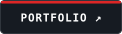</a>
    <a href="https://www.linkedin.com/in/imeshsan2008/">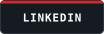</a>
    <a href="https://www.instagram.com/imeshsan2008/">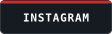</a>
    <a href="mailto:imeshbota0@gmail.com">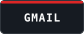</a>
    
    
  

   

  <!-- LIVE PHYSICS CONTRIBUTION BREAKOUT CONSOLE (Clicks directly into 60FPS Arcade on Portfolio!) -->
  <a href="https://imeshsan2008.github.io/arcade.html">
    <picture>
      <source media="(prefers-color-scheme: dark)" srcset="./assets/breakout-dark.svg" />
      <source media="(prefers-color-scheme: light)" srcset="./assets/breakout-light.svg" />
      
    </picture>
  </a>

    

  <!-- SELECTED ENGINEERING BUILDS — 2x2 INDIVIDUALLY CLICKABLE BENTO CARDS -->
  

    <a href="https://github.com/imeshsan2008/MySLT_Tracker">
      <picture>
        <source media="(prefers-color-scheme: dark)" srcset="./assets/proj-myslt-dark.svg" />
        <source media="(prefers-color-scheme: light)" srcset="./assets/proj-myslt-light.svg" />
        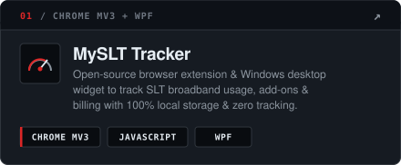
      </picture>
    </a>
    <a href="https://github.com/imeshsan2008/AdobeShield">
      <picture>
        <source media="(prefers-color-scheme: dark)" srcset="./assets/proj-adobeshield-dark.svg" />
        <source media="(prefers-color-scheme: light)" srcset="./assets/proj-adobeshield-light.svg" />
        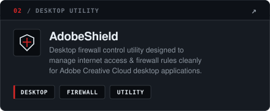
      </picture>
    </a>
  

  

    <a href="https://github.com/imeshsan2008/Trainify">
      <picture>
        <source media="(prefers-color-scheme: dark)" srcset="./assets/proj-trainify-dark.svg" />
        <source media="(prefers-color-scheme: light)" srcset="./assets/proj-trainify-light.svg" />
        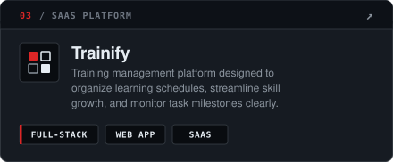
      </picture>
    </a>
    <a href="https://github.com/imeshsan2008/ShareBox">
      <picture>
        <source media="(prefers-color-scheme: dark)" srcset="./assets/proj-sharebox-dark.svg" />
        <source media="(prefers-color-scheme: light)" srcset="./assets/proj-sharebox-light.svg" />
        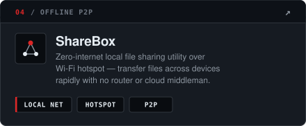
      </picture>
    </a>
  

  <strong>MORE BUILDS:</strong> <a href="https://github.com/imeshsan2008/qr">VenomQR Studio</a> · <a href="https://github.com/imeshsan2008/magicframe">Magic Frame</a> · <a href="https://github.com/imeshsan2008/mediax">MediaX</a> · <a href="https://imeshsan2008.github.io/">All Projects ↗</a>

    

  <!-- 3-PANEL LIVE GITHUB TELEMETRY & 12-WEEK ANIMATED PULSE -->
  <picture>
    <source media="(prefers-color-scheme: dark)" srcset="./assets/telemetry-dark.svg" />
    <source media="(prefers-color-scheme: light)" srcset="./assets/telemetry-light.svg" />
    
  </picture>

    

  <!-- SYSTEM CAPABILITIES & CONNECTED CAREER TIMELINE BLUEPRINT -->
  <picture>
    <source media="(prefers-color-scheme: dark)" srcset="./assets/blueprint-dark.svg" />
    <source media="(prefers-color-scheme: light)" srcset="./assets/blueprint-light.svg" />
    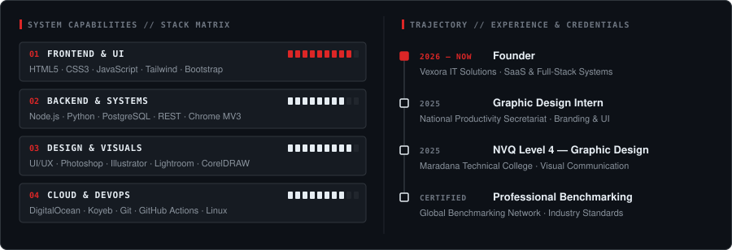
  </picture>

 

  
<code>CLASSIC VIEW // CONTRIBUTION SNAKE &amp; SYSTEM ARCHITECTURE</code>

   
  

    <picture>
      <source media="(prefers-color-scheme: dark)" srcset="https://raw.githubusercontent.com/imeshsan2008/imeshsan2008/output/github-snake-dark.svg" />
      <source media="(prefers-color-scheme: light)" srcset="https://raw.githubusercontent.com/imeshsan2008/imeshsan2008/output/github-snake-light.svg" />
      
    </picture>
  

   
  <ul>
    <li><strong>Physics Engine (Pure JS):</strong> <a href="./scripts/breakout-engine.mjs"><code>scripts/breakout-engine.mjs</code></a> simulates 2D AABB-circle collisions against live GitHub commits and compiles exact keyframes into flat SMIL SVGs.</li>
    <li><strong>Profile OS Builder (Node.js):</strong> <a href="./scripts/build-profile.mjs"><code>scripts/build-profile.mjs</code></a> syncs live telemetry, 12-week contribution pulse, Bento cards, and exports <a href="./assets/contrib.json"><code>assets/contrib.json</code></a> daily via <a href="./.github/workflows/update-profile.yml"><code>update-profile.yml</code></a>.</li>
    <li><strong>60FPS Playable Portfolio Arcade:</strong> <a href="https://imeshsan2008.github.io/arcade.html"><code>imeshsan2008.github.io/arcade.html</code></a> hosts 3 zero-glow, zero-login HTML5 Canvas games synced live to GitHub commits.</li>
  </ul>

 

  <code>IMESH // OS v2.6</code> · Pure JavaScript Engine · Zero Glow · Auto-Synced Daily · <a href="https://imeshsan2008.github.io/">imeshsan2008.github.io</a>

