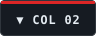
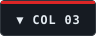
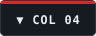
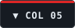
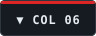
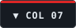
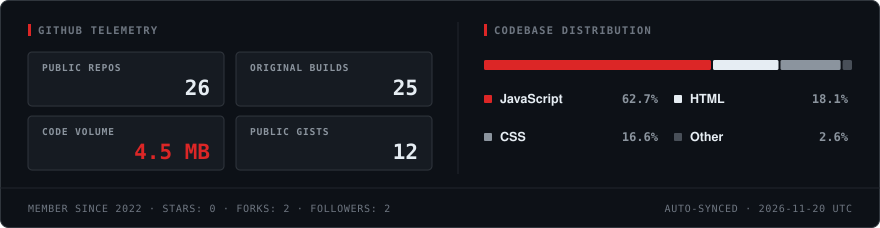

  <picture>
    <source media="(prefers-color-scheme: dark)" srcset="./assets/hero-dark.svg" />
    <source media="(prefers-color-scheme: light)" srcset="./assets/hero-light.svg" />
    
  </picture>

    

  

    
    
    
    
    
    
  

---

### `01` — About

Full-Stack Developer, Web & Graphic Designer based in **Kelaniya, Sri Lanka**, and Founder of **Vexora IT Solutions**. I design and ship scalable SaaS applications, privacy-first Chrome extensions, Python desktop utilities, and crisp visual systems — focused on clean architecture, speed, and zero visual clutter.

---

### `02` — Play Connect Four vs. AI *(Live Interactive Game)*

Challenge my automated **Depth-5 Minimax AI** directly from this README. Pick a column below, submit the pre-filled issue, and GitHub Actions will compute the AI counter-move and redraw the board automatically in ~15 seconds.

<!-- CONNECT4:START -->

  <picture>
    <source media="(prefers-color-scheme: dark)" srcset="./assets/connect4-dark.svg" />
    <source media="(prefers-color-scheme: light)" srcset="./assets/connect4-light.svg" />
    
  </picture>
    
  

  
  
  
  
  
  
  
  

  

    
  

<!-- CONNECT4:END -->

<strong>How to play &amp; engine specs</strong>

1. Click any open column button (`▼ COL 01` – `▼ COL 07`) above.
2. On the pre-filled GitHub Issue page, click **Submit new issue** — no edits needed.
3. The [`connect4.yml`](./.github/workflows/connect4.yml) workflow executes [`scripts/connect4.py`](./scripts/connect4.py) with an **Alpha-Beta Minimax (Depth 5)** engine, updates [`game/state.json`](./game/state.json), re-renders both dark & light SVGs, replies with the move outcome, and closes the issue automatically.
4. Refresh this profile to see your crimson disc drop and the AI's counter-move. Anyone on GitHub can join the active match or click **↻ NEW GAME** to start a fresh round!

---

### `03` — Selected Builds

<table>
  <tr>
    <td width="50%" valign="top">
      <h4><a href="https://github.com/imeshsan2008/MySLT_Tracker">MySLT Tracker</a></h4>
      
Open-source Chrome Manifest V3 extension &amp; Windows desktop widget to track SLT broadband usage, add-ons, and billing with 100% local storage and zero data collection.

      <code>Chrome MV3</code> · <code>JavaScript</code> · <code>WPF</code>
    </td>
    <td width="50%" valign="top">
      <h4><a href="https://github.com/imeshsan2008/AdobeShield">AdobeShield</a></h4>
      
Clean desktop utility built with Python &amp; ttkbootstrap to manage firewall rules and internet connectivity for Adobe Creative Cloud apps cleanly.

      <code>Python</code> · <code>ttkbootstrap</code> · <code>Windows Firewall</code>
    </td>
  </tr>
  <tr>
    <td width="50%" valign="top">
      <h4><a href="https://github.com/imeshsan2008/Trainify">Trainify</a></h4>
      
Training management platform built to organize learning schedules, track skill development milestones, and manage tasks efficiently.

      <code>Full-Stack</code> · <code>Web App</code> · <code>SaaS</code>
    </td>
    <td width="50%" valign="top">
      <h4><a href="https://github.com/imeshsan2008/ShareBox">ShareBox</a></h4>
      
Fast, offline peer-to-peer local file sharing over Wi-Fi hotspot — transfer files across devices with zero router or internet required.

      <code>Python</code> · <code>Local Network</code> · <code>Utility</code>
    </td>
  </tr>
</table>

> **More systems:** [VenomQR Studio](https://github.com/imeshsan2008/qr) · [Magic Frame](https://github.com/imeshsan2008/magicframe) · [MediaX](https://github.com/imeshsan2008/mediax) · [Full Portfolio ↗](https://imeshsan2008.github.io/)

---

### `04` — GitHub Telemetry

  <picture>
    <source media="(prefers-color-scheme: dark)" srcset="./assets/stats-dark.svg" />
    <source media="(prefers-color-scheme: light)" srcset="./assets/stats-light.svg" />
    
  </picture>

---

### `05` — Tech Stack & Capabilities

| Domain | Technologies & Tools |
| :--- | :--- |
| **Frontend & UI** | `HTML5` · `CSS3` · `JavaScript` · `Tailwind CSS` · `Bootstrap` · `Responsive Systems` |
| **Backend & Systems** | `Node.js` · `Python` · `PostgreSQL` · `REST APIs` · `MVC Architecture` · `Chrome MV3` |
| **Design & Visuals** | `UI/UX Design` · `Adobe Photoshop` · `Adobe Illustrator` · `Adobe Lightroom` · `CorelDRAW` |
| **Cloud & Tooling** | `DigitalOcean` · `Koyeb` · `Git` · `GitHub Actions` · `Production Linux` |

---

### `06` — Journey & Credentials

| Period | Role / Credential | Organization |
| :--- | :--- | :--- |
| **2026 — Present** | **Founder** — Full-Stack Web & SaaS Solutions | Vexora IT Solutions |
| **2025** | **Graphic Design Intern** — Branding, UI Assets & Layouts | National Productivity Secretariat |
| **2025** | **NVQ Level 4 — Graphic Design** | Maradana Technical College |
| **Certification** | **Professional Benchmarking** | Global Benchmarking Network |

---

### `07` — Contribution Snake

  <picture>
    <source media="(prefers-color-scheme: dark)" srcset="https://raw.githubusercontent.com/imeshsan2008/imeshsan2008/output/github-snake-dark.svg" />
    <source media="(prefers-color-scheme: light)" srcset="https://raw.githubusercontent.com/imeshsan2008/imeshsan2008/output/github-snake-light.svg" />
    
  </picture>

---

  Built with crisp flat geometry — zero glow, 100% automated · <a href="https://imeshsan2008.github.io/">imeshsan2008.github.io</a>

